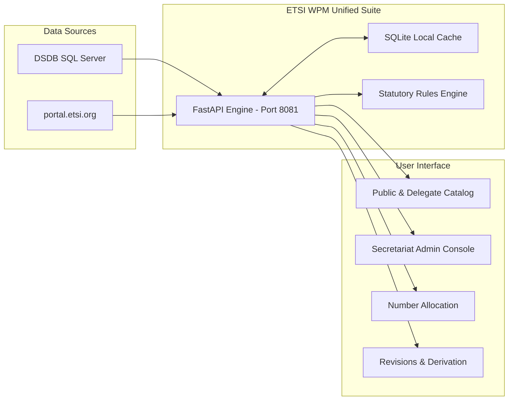

# ETSI Work Programme Management Unified Suite - User Guide & Wiki

Welcome to the official **Operational Manual and Technical Wiki** for the **ETSI WPM Unified Suite**.

This system unifies two historical ETSI applications into a high-performance modern web platform:
1. **WPM Desktop Back-Office**: The legacy Visual Basic 6 desktop administration client used by the ETSI Secretariat General for work item creation, document numbering, waterfall scheduling, and statutory parent-child revisions.
2. **WPM Web Portal**: The delegate and public search engine hosted on `portal.etsi.org` for consulting, tracking milestones, downloading published deliverables, and querying European Commission standardization mandates.

---

## Key System Highlights

- **Unified Operation**: Complete management of over 70,000 standardization deliverables and 176 Technical Bodies across all deliverable types: `EN`, `TS`, `TR`, `ES`, `EG`, `SR`, and `GS`.
- **Institutional Statutory Rules**:
  - Standard number allocation rule: document numbers must be greater than or equal to 1000 for standard deliverables.
  - ISG and legacy ETS rule: numbers strictly under 1000 and technical body scoped.
  - Automatic Parent-Child Retirement: creating a formal revision automatically marks the predecessor parent as `Stopped - Revised` with timestamped lifecycle audit notes.
  - Waterfall Milestones: automatic cascade calculation based on statutory durations.
- **Dockerized Architecture**: Non-root deployment, automated healthcheck, volume persistence on port `8081`.

---

## Documentation Structure

| Section | Description |
| :--- | :--- |
| **[Getting Started](quick-start.md)** | Initial setup, workstation navigation, keyboard shortcuts, and user roles. |
| **[Catalog & Advanced Search](modules/catalog-search.md)** | Querying deliverables, real-time filters, PDF and Word downloads, and favorites. |
| **[Detailed Deliverable Profile](modules/deliverable-profile.md)** | 360-degree drawer view, project officers, waterfall milestones, spectrum, and remarks. |
| **[Admin Console](modules/admin-console.md)** | Back-office deliverable creation, status transitions, lifecycle audit, and editing. |
| **[Number Allocation Engine](modules/numbering-allocation.md)** | Statutory standard numbering generator implementing ETSI Directives. |
| **[Revisions & Derivation Engine](modules/revisions-derivation.md)** | Cloning deliverables for revisions, splits, transfers, and duplicate deliverables. |
| **[Statutory Schedule & Perfect Plan](modules/statutory-schedule.md)** | Milestone schedule generation and critical path waterfall computation. |
| **[Radio Spectrum & EU Mandates](modules/spectrum-mandates.md)** | RED Directive 2014/53/EU frequency bands and European Commission requests. |
| **[Portal & Database Synchronization](modules/portal-sync-dsdb.md)** | Real-time live synchronization with `portal.etsi.org` and DSDB SQL Server. |
| **[ETSI Standards Glossary & FAQ](glossary-faq.md)** | Institutional standard types, statutory milestone codes, acronyms, and FAQ. |
| **[Technical Architecture & Docker](modules/technical-architecture.md)** | FastAPI backend, SQLite schema, Docker Compose, and REST API specification. |
