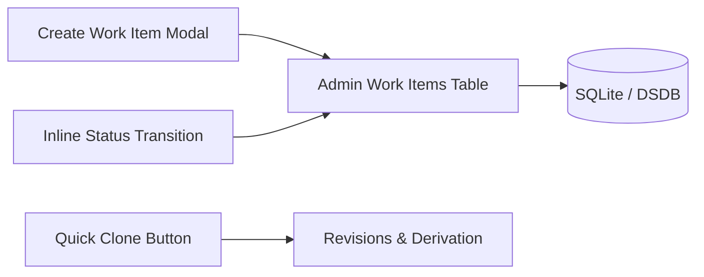
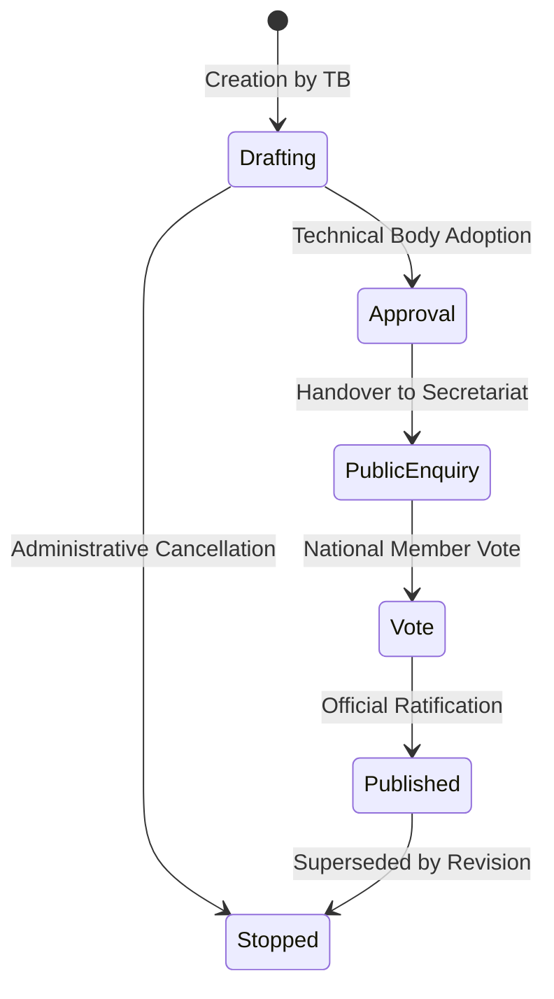

# Admin Console - WPM Back-Office

The **Admin Console** reproduces and modernizes the complete operational capabilities of the legacy **WPM.exe** Visual Basic 6 desktop application used by the ETSI Secretariat.

---

## Operational Overview

The Admin Console provides direct administrative oversight of all standardization records:

### Key Administrative Controls
- **Deliverable Creation**: Launch new work programmes with complete statutory metadata.
- **Direct Status Modification**: Fast update of work item state codes without leaving the table.
- **Predecessor & Successor Tracking**: Identify parents and revisions in real time.
- **Quick Clone Shortcut**: Transfer any deliverable into the derivation engine with a single click.

---

## Creating a New Work Item

Clicking the **New Work Item** button in the header opens the comprehensive work item creation modal:

### Mandatory Fields
1. **Deliverable Type**: Select from `EN`, `TS`, `TR`, `ES`, `EG`, `SR`, or `GS`.
2. **Document Number**: Numeric identifier respecting statutory series rules (e.g. `303645`).
3. **Technical Body**: Responsible committee or group.
4. **Title Part 1**: Mandatory main standard title.
5. **Project Officers**: Designated Rapporteur and Secretariat Support Officer.

### Optional Statutory Parameters
- **Title Parts 2 & 3**: Subtitle and part designation.
- **Standstill Obligation**: Toggle standstill requirement for European Standards.
- **Harmonised Standard**: Declare compliance with European Commission standardization requests.
- **Target Publication Date**: Target milestone date.
- **Scope & Objective**: Detailed narrative justifying standardization work.

---

## Status Transition Lifecycle

The system strictly tracks standard state codes:
- `DRAFT` / `underconst`: Active drafting within the Technical Body.
- `ENQUIRY` / `approval`: Undergoing public enquiry or member vote.
- `PUBLISHED` / `finalized`: Formally adopted and published standard.
- `STOPPED` / `stopped`: Formally cancelled, retired, or superseded by a newer revision.
