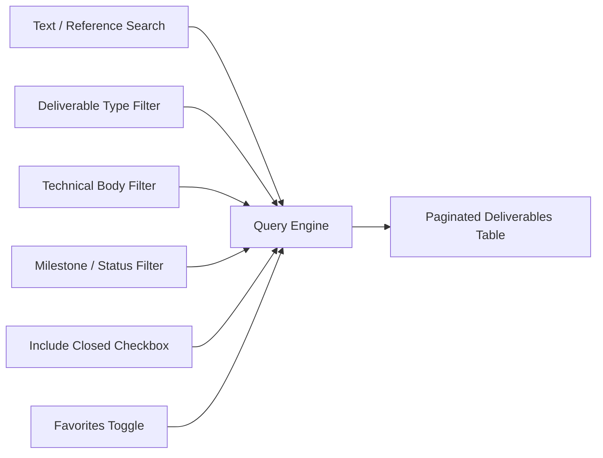

# Catalog & Advanced Search

The **Catalog & Search** module provides a modern, fast search interface across the entire ETSI Work Programme catalog.

---

## Search & Filter Capabilities

The search panel offers multi-criteria filtering:

### Search Criteria
- **Text or Reference**: Query by document number (e.g. `303645`), Work Item ID (e.g. `DEN/CYBER-0072`), keywords in the title, or scope description.
- **Deliverable Type**: Filter by formal ETSI deliverable category:
  - `EN`: European Standard
  - `TS`: Technical Specification
  - `TR`: Technical Report
  - `ES`: ETSI Standard
  - `EG`: ETSI Guide
  - `SR`: Special Report
  - `GS`: Group Specification
- **Technical Body**: Filter across all 176 official ETSI Technical Bodies (e.g. `CYBER`, `ERM`, `3GPP`, `DATA`, `EMTEL`, `MEC`, `ATTM`, `DECT`).
- **Status / Milestone**: Filter by statutory state (`Drafting`, `Public Enquiry`, `National Vote`, `Published`, `Stopped`).
- **Include Closed Deliverables**: By default, stopped and retired deliverables are hidden. Checking this box surfaces all historical and superseded standards.
- **Favorites Only**: Filters the table to display only deliverables bookmarked by the user.

---

## Deliverables Table Overview

The catalog displays key metadata in structured columns:

| Column | Description |
| :--- | :--- |
| **Favorite** | Star toggle to pin deliverables for quick access. |
| **Reference & ID** | Official deliverable designation and unique Work Item identifier. |
| **Version** | Semantic edition string (e.g. `v1.1.1`, `v2.2.3`). |
| **Technical Body** | Sponsoring committee pill (e.g. `CYBER`, `3GPP`, `ERM`). |
| **Deliverable Title** | Official standardization scope and title parts. |
| **Status & Date** | Current lifecycle badge and effective milestone date. |
| **Download** | Direct access to official publication PDF and editable Word source archive. |
| **Actions** | Open the 360-degree detailed inspection drawer. |

---

## Exporting Catalog Data

Delegates and officers can export the current filtered query at any time:
- **CSV Export**: Formatted spreadsheet compatible with Microsoft Excel, containing reference, title, committee, status, rapporteur, and target dates.
- **JSON Export**: Raw structured array suitable for API integration, automated CI pipelines, and external reporting.
