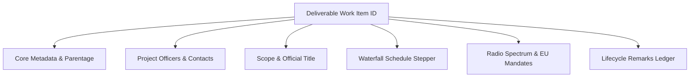

# Detailed Deliverable Profile

Clicking the **Detail** action button or deliverable reference opens an in-depth 360-degree operational side panel.

---

## Deliverable Profile Sections

The drawer aggregates all institutional data associated with an ETSI standard:

### 1. Core Metadata & Statutory Flags
- **Work Item ID**: Canonical administrative handle (e.g. `REN/ERM-TG28-560`).
- **Deliverable Type & Class**: Standard classification (`EN`, `TS`, `GS`...).
- **Standstill Flag**: Indicates whether national standards bodies must freeze conflicting national specifications during drafting.
- **Harmonised Standard**: Denotes whether the deliverable is aimed at citation in the Official Journal of the European Union under EU Directives.
- **Parent Deliverable**: If the standard was derived from a revision or split, an interactive link points directly to the predecessor work item.

### 2. Project Officers
- **Rapporteur**: Designated editor responsible for text drafting, with active email link.
- **Technical Officer**: Secretariat General representative overseeing statutory procedural compliance.

### 3. Waterfall Schedule Stepper
An interactive visual timeline tracks every statutory milestone from inception to publication:
- Step completion indicators: `Achieved`, `In Progress`, `Pending`.
- Milestone codes: `TB_ADOPT`, `HANDOVER`, `PE_START`, `PE_CLOSE`, `VOTE_START`, `PUBLISH`.
- Target dates and statutory duration in calendar days.

### 4. Radio Spectrum Allocation
Displays radio spectrum bands allocated under RED Directive 2014/53/EU:
- Low and high frequency bounds.
- Frequency unit (`MHz`, `GHz`, `kHz`).
- Radio service application description (e.g. `Short Range Devices SRD`).

### 5. European Commission Mandates
Surfaces formal standardization requests issued by the European Commission:
- Mandate identifier (e.g. `M/585`).
- Directive reference (e.g. `RED Directive 2014/53/EU`).
- Legislative justification and policy objective.

### 6. Remarks & Audit Ledger
A persistent audit trail recording:
- Procedural changes and milestone approvals.
- Direct Secretariat and Rapporteur operational notes.
- Quick submission form to log timestamped remarks into the permanent database.
