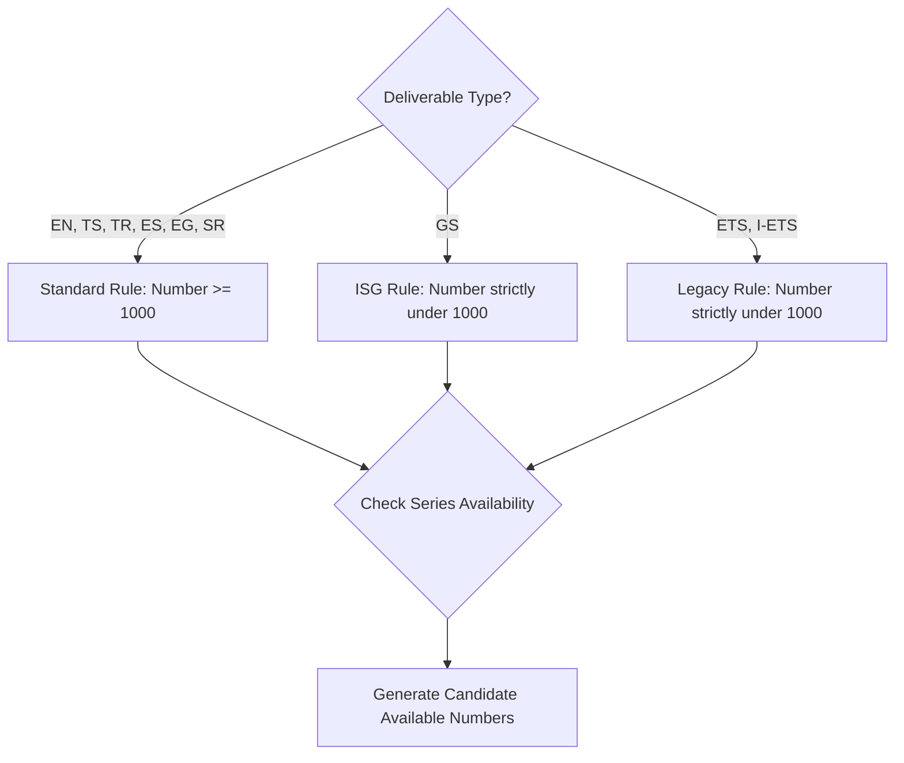

# Number Allocation Engine

The **Number Allocation** module re-implements the institutional numbering algorithms of the legacy `frmNextETSINumber` dialog according to the ETSI Directives.

---

## Statutory Numbering Rules

ETSI deliverables are governed by strict numerical series rules enforced by the system:

### 1. Standard Deliverables Rule
Applicable to `EN`, `TS`, `TR`, `ES`, `EG`, and `SR`:
- **Constraint**: Document number must be strictly greater than or equal to 1000.
- **Official Series**:
  - `101 xxx`: Technical Specifications and Reports.
  - `300 xxx` & `303 xxx`: European Standards and Harmonised Standards.
- Any attempt to create a standard with a number below 1000 triggers an automated validation rejection.

### 2. Group Specifications Rule
Applicable to Industry Specification Groups `GS`:
- **Constraint**: Number must be strictly under 1000 (e.g. `001`, `024`).
- **Scoping**: Group numbers are scoped to the specific Industry Specification Group (e.g. `ISG ENI`, `ISG NFV`, `MEC`).

### 3. Legacy European Telecommunication Standards
Applicable to legacy `ETS` and `I-ETS`:
- **Constraint**: Number must be strictly under 1000 (e.g. `300`).

---

## Operating the Generator

From the **Number Allocation** tab:

1. Select the **Deliverable Type** (`EN`, `TS`, `TR`, `GS`...).
2. Select the **Associated Technical Body**.
3. Click **Compute Next Free Number**:
   - The engine audits the database to identify the highest assigned document number.
   - Calculates the next sequential available identifier.
   - Generates candidate free numbers displayed as one-click selectable pills.
4. Click **Use in New Deliverable**:
   - Automatically opens the deliverable creation modal pre-filled with the allocated number and committee.
