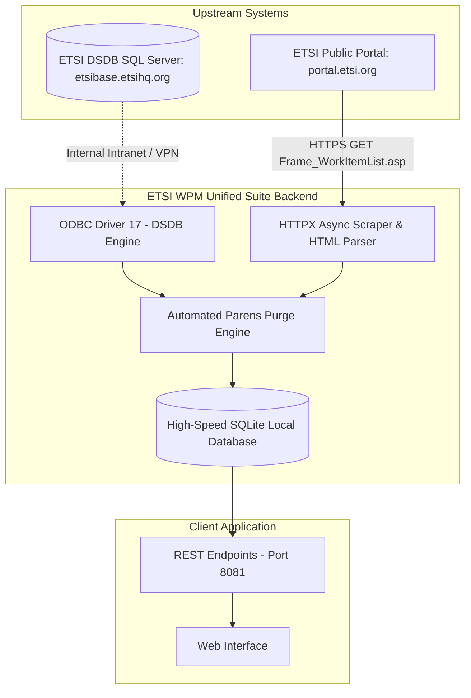

# Portal & Database Synchronization

The **Portal & Database Synchronization** subsystem provides dual-source data integration, combining direct SQL Server access with asynchronous web scraping.

---

## Synchronization Architecture

---

## 1. Public Portal Synchronization (portal.etsi.org)

When offline or operating outside the ETSI corporate intranet, the application synchronizes against the public portal:

### Scraping Protocol
- **Target URL**: `https://portal.etsi.org/webapp/WorkProgram/Frame_WorkItemList.asp`
- **Protocol**: Asynchronous HTTP client with connection pooling, automatic redirect resolution, and retry backoff.
- **HTML Parsing Engine**:
  - Regular expression parser extracting Work Item IDs, standard references, semantic versions, technical body identifiers, and status strings.
  - Automatic download URL extraction for official publication PDFs and editable Word source archives (`.zip`).
- **Dynamic Filter Support**: Clicking **Sync Portal** in the header automatically passes the active search query, technical body, or deliverable type filter to fetch matching deliverables.

---

## 2. Direct DSDB Database Synchronization (SQL Server)

When connected to the ETSI local network in Sophia Antipolis or via the official GlobalProtect VPN, the system can connect directly to the master corporate database:

### DSDB Configuration Parameters
- **Server Address**: `172.27.2.40:1433` (`etsibase.etsihq.org`).
- **Database Name**: `DSDB`.
- **Driver**: `ODBC Driver 17 for SQL Server`.
- **Primary Tables Synchronized**:
  - `dbo.WORK_ITEM`: Core deliverable master records, status dates, and stop flags.
  - `dbo.TAB_TB`: All active Technical Bodies, titles, and lead organizational bodies.
  - `dbo.MILESTONES`: Statutory milestone templates and achieved dates.

---

## 3. Automated Sanitation & Integrity Engine

Every incoming deliverable record—whether originating from DSDB or the web scraper—passes through an automated integrity pipeline:
- **Parentheses Purge**: Removes all parenthetical expressions to maintain strict naming conventions.
- **Deduplication**: Conflict resolution uses SQLite `ON CONFLICT(wki_id) DO UPDATE` to ensure local edits and remarks are never lost.
- **Reference Normalization**: Ensures standards identifiers conform to official ETSI nomenclature (e.g. `ETSI EN 303 645`).
