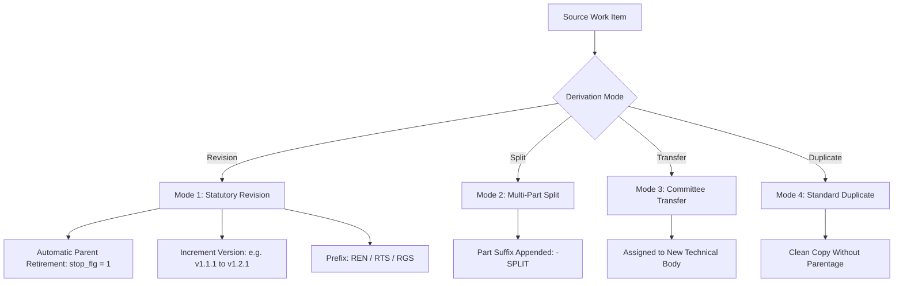

# Revisions & Derivation Engine

The **Revisions & Derivation** module modernizes the functionality of the legacy `frmCloneWI` suite. It enables official standard life-cycle progression, multi-part splitting, committee transfers, and deliverable replication.

---

## The 4 Derivation Modes

### 1. Statutory Revision
Used to release a new version of an existing published standard:
- **Version Increment**: Increments minor version (e.g. `v1.1.1` becomes `v1.2.1`).
- **Identifier Prefix**: The Work Item ID switches from drafting prefix `D` to revision prefix `R` (e.g. `DEN/CYBER-0072` becomes `REN/CYBER-0072`).
- **Automatic Parent Retirement Rule**: The parent deliverable is automatically retired:
  - `stop_flg` is set to `1`.
  - `status` is set to `Stopped - Revised`.
  - `stop_date` is stamped with today's date.
  - A permanent audit remark is logged into the parent's ledger: `Automatically stopped due to Revision creation -> REN/...`.

### 2. Multi-Part Split
Used when an existing monolithic deliverable is divided into multiple independent parts (e.g. Part 1: Core Protocol, Part 2: Test Suite):
- Generates a derived work item with a `-SPLIT` suffix.
- Maintains parentage references without stopping the predecessor.

### 3. Technical Body Transfer
Used when standardization maintenance is transferred from one committee to another (e.g. from an Industry Specification Group to a permanent Technical Committee):
- Reassigns technical body leadership while preserving the original technical scope.

### 4. Standard Duplicate
Creates a clean copy for parallel development without establishing statutory parent-child constraints.

---

## Derivation Configuration Options

When launching a derivation:
- **Schedule Handling**: Choose between applying the default statutory waterfall milestones, cloning the parent's actual milestone schedule, or leaving the schedule blank.
- **Retain Comments & Remarks**: Option to copy historical remarks into the new deliverable.
- **Retain Mandates**: Carry over European Commission standardization requests to the new edition.
