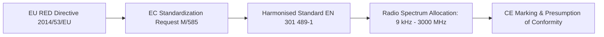

# Radio Spectrum & EU Mandates

The **Spectrum & EU Mandates** module oversees radio equipment frequency band allocations and tracks standardization requests issued by the European Commission.

---

## Radio Spectrum Management

Under the European Union **Radio Equipment Directive 2014/53/EU**, Harmonised Standards must define technical requirements for radio transmitters and receivers operating across specific frequency bands:

### Frequency Allocation Data Model
Each frequency allocation record tracks:
- **Associated Work Item ID**: The standard governing the equipment.
- **Low Frequency**: Lower spectrum boundary (e.g. `9.0`).
- **High Frequency**: Upper spectrum boundary (e.g. `3000.0`).
- **Frequency Unit**: `kHz`, `MHz`, or `GHz`.
- **Radio Service Application**: Designated radio service (e.g. `Short Range Devices SRD`, `Broad Spectrum EMC`).

### Adding a Frequency Allocation
1. Click **Add Spectrum Band** from the tab or deliverable drawer.
2. Select the target Work Item.
3. Input the frequency bounds and select the unit.
4. Specify the radio application and submit to save into the database.

---

## European Commission Mandates

The European Commission regularly issues formal Standardisation Requests (historically termed Mandates) under Regulation (EU) 1025/2012:

### Key Mandates Tracked in ETSI WPM
- **Mandate M/585**: Commission Standardisation Request for cybersecurity in IoT consumer connected radio equipment.
- **RED Article 3.1(a)**: Health and safety essential requirements.
- **RED Article 3.1(b)**: Electromagnetic compatibility essential requirements.
- **RED Article 3.2**: Effective and efficient use of radio spectrum to avoid harmful interference.
- **RED Article 3.3**: Specific requirements including network protection, personal data privacy, and fraud prevention.

### Mandate Record Details
- **Mandate Code**: Formal identifier (e.g. `M/585`).
- **Directive Reference**: Underlying EU legislation.
- **Official Scope & Description**: Exact legal and policy mandate text.
- **Harmonised Standards Citation**: Links to ETSI deliverables cited in the Official Journal of the European Union.
