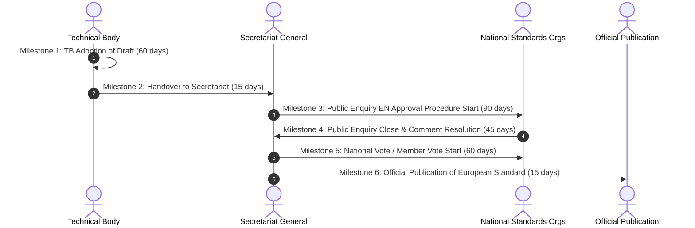

# Statutory Schedule & Perfect Plan

The **Statutory Schedule** module calculates and simulates milestone timelines according to the formal waterfall schedules codified in the ETSI Directives.

---

## Waterfall Milestone Workflow

European Standards and Technical Specifications must follow a strict statutory sequence:

---

## Standard Milestone Templates

### European Standard Template
- `TB_ADOPT`: Technical Body Adoption of Draft (60 calendar days).
- `HANDOVER`: Handover to Secretariat for processing (15 calendar days).
- `PE_START`: Public Enquiry start with National Standards Organizations (90 calendar days).
- `PE_CLOSE`: Public Enquiry close and resolution of member comments (45 calendar days).
- `VOTE_START`: National vote launch (60 calendar days).
- `PUBLISH`: Final ratification and publication (15 calendar days).
- **Total Standard Duration**: 285 calendar days.

### Technical Specification Template
- `TB_ADOPT`: Technical Body Adoption of Draft (45 calendar days).
- `HANDOVER`: Handover to Technical Editor (15 calendar days).
- `MEMB_APPR`: Technical Body Member Approval (30 calendar days).
- `PUBLISH`: Publication as Technical Specification (10 calendar days).
- **Total Standard Duration**: 100 calendar days.

---

## Generating a Perfect Plan

From the **Statutory Schedule** tab:

1. Select the **Deliverable Type** (`EN`, `TS`, `TR`).
2. Select the responsible **Technical Body**.
3. Choose the **Project Inception Date** (defaults to today's date).
4. Click **Compute Waterfall Plan**:
   - The engine iterates through the milestone sequence, calculating sequential target dates by adding statutory duration offsets.
   - The calculated schedule is rendered in an interactive table with milestone codes, names, duration days, and computed target deadlines.
