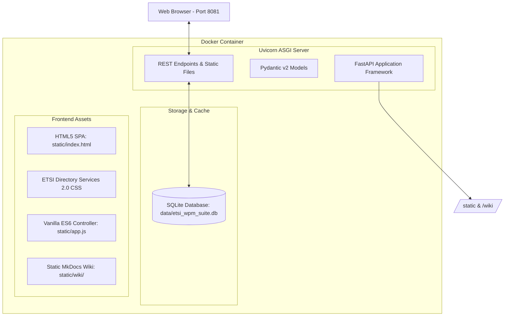

# Technical Architecture & Docker

This document provides a comprehensive technical reference for the ETSI WPM Unified Suite architecture, runtime environment, data models, and deployment configurations.

---

## High-Level System Architecture



---

## Technology Stack

- **Backend Runtime**: Python 3.11+ / Python 3.14.
- **Web Framework**: FastAPI (modern async REST API framework with automated OpenAPI / Swagger docs).
- **ASGI Server**: Uvicorn with multi-worker support.
- **Database Engine**: SQLite 3 with WAL mode, foreign keys, and transaction integrity.
- **Frontend Engine**: Vanilla ES6 JavaScript (zero heavy node runtime dependencies), Lucide Icons, KaTeX for math rendering.
- **Containerization**: Docker & Docker Compose with non-root security context.

---

## Database Schema Reference

The database `data/etsi_wpm_suite.db` consists of 7 primary tables:

1. **`work_items`**:
   - `wki_id` (TEXT, PK): Unique work item identifier.
   - `doc_type` (TEXT): Standard category (`EN`, `TS`, `TR`, `ES`, `EG`, `SR`, `GS`).
   - `doc_number` (TEXT): Document number.
   - `version` (TEXT): Semantic version (e.g. `v1.1.1`).
   - `reference` (TEXT): Formal reference (e.g. `ETSI EN 303 645`).
   - `technical_body` (TEXT): Responsible committee or group.
   - `title_part1`, `title_part2`, `title_part3`, `full_title` (TEXT).
   - `status`, `state_code`, `status_date` (TEXT).
   - `stop_flg` (INTEGER): `0` for active, `1` for stopped/retired.
   - `pdf_url`, `word_url`, `detail_url` (TEXT).
2. **`technical_bodies_cache`**:
   - `tb_id` (TEXT, PK), `code` (TEXT), `name` (TEXT), `lead` (TEXT).
3. **`work_item_schedules`**:
   - `sched_id` (INT, PK), `wki_id` (FK), `mls_code`, `mls_name`, `sched_position`, `duration_days`, `target_date`, `status`.
4. **`work_item_frequencies`**:
   - `freq_id` (INT, PK), `wki_id` (FK), `low_freq`, `high_freq`, `unit`, `service_app`.
5. **`work_item_mandates`**:
   - `mandate_id` (INT, PK), `wki_id` (FK), `mandate_code`, `directive_ref`, `descript`.
6. **`work_item_remarks`**:
   - `remark_id` (INT, PK), `wki_id` (FK), `remark_type`, `remark_text`, `author`, `created_at`.
7. **`favorites`**:
   - `wki_id` (TEXT, PK), `doc_number`, `title`, `technical_body`, `status`, `created_at`.

---

## Docker & Container Deployment

### Dockerfile Specification
```dockerfile
FROM python:3.11-slim

WORKDIR /app

RUN apt-get update && apt-get install -y --no-install-recommends \
    curl \
    && rm -rf /var/lib/apt/lists/*

COPY requirements.txt .
RUN pip install --no-cache-dir -r requirements.txt

COPY . .

RUN groupadd -g 1000 etsi && \
    useradd -u 1000 -g etsi -m -s /bin/bash etsi && \
    mkdir -p /app/data && \
    chown -R etsi:etsi /app

USER etsi

ENV PORT=8081
EXPOSE 8081

HEALTHCHECK --interval=15s --timeout=5s --start-period=5s --retries=3 \
  CMD curl -f http://localhost:8081/api/health || exit 1

CMD ["python", "run.py"]
```

### Docker Compose Configuration
```yaml
version: '3.8'

services:
  etsi-wpm-suite:
    build: .
    container_name: etsi-wpm-suite
    restart: unless-stopped
    ports:
      - "8081:8081"
    environment:
      - PORT=8081
      - DATA_DIR=/app/data
    volumes:
      - ./data:/app/data
    healthcheck:
      test: ["CMD", "curl", "-f", "http://localhost:8081/api/health"]
      interval: 15s
      timeout: 5s
      retries: 3
      start_period: 5s
```

### Launch Commands
```bash
# Build and start containerized stack on port 8081
docker compose up -d --build

# Inspect logs
docker compose logs -f

# Verify container health
docker ps
```
