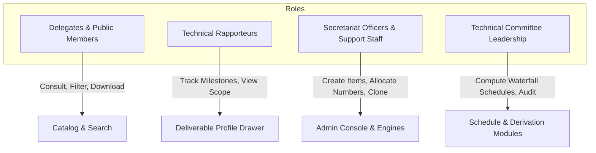

# Getting Started with ETSI WPM Unified Suite

This guide explains how to access, navigate, and utilize the unified ETSI Work Programme Management application.

---

## Access & Workstation Environment

The ETSI WPM Unified Suite runs as a self-contained service accessible via modern web browsers:

- **Local Workstation URL**: [http://localhost:8081](http://localhost:8081)
- **Primary Port**: `8081`
- **Supported Browsers**: Google Chrome, Mozilla Firefox, Microsoft Edge, Safari.
- **Network Requirements**:
  - Offline mode: Fully operational using the local high-speed SQLite database cache.
  - Live Synchronization mode: Connect to the ETSI local network or GlobalProtect VPN for DSDB access and external public portal queries.

---

## User Roles & Operational Responsibilities

1. **Delegates & Technical Experts**:
   - Search published and in-progress standards across technical bodies.
   - Bookmark critical deliverables into personal favorites.
   - Download official publication PDFs and editable Word source archives.
2. **Rapporteurs**:
   - Inspect assigned work items, milestone deadlines, and scope remarks.
   - Submit progress notes into the deliverable remarks ledger.
3. **Secretariat Support Officers**:
   - Allocate official ETSI standard numbers respecting directives.
   - Launch revisions, splits, and transfers.
   - Oversee statutory waterfall milestone transitions.
4. **Directorate General & Technical Committee Leadership**:
   - Audit overall work programme health via certified KPIs.
   - Verify European Commission standardization mandate compliance.

---

## Navigation & Workspace Layout

The application interface is structured into three zones:

1. **Top Header**:
   - System operational status indicator.
   - Primary action buttons: `New Work Item`, `Sync Portal`, `CSV Export`, `JSON Export`, and `User Guide & Wiki`.
2. **Interactive Tab Bar**:
   - **Catalog & Search**: The primary search engine and consultation table.
   - **Admin Console**: Back-office list with status editing and lifecycle controls.
   - **Number Allocation**: Statutory document number generator.
   - **Revisions & Derivation**: Cloning engine for revisions, splits, and transfers.
   - **Statutory Schedule**: Waterfall timeline milestone calculator.
   - **Spectrum & EU Mandates**: Radio frequency spectrum and EC mandate tracker.
3. **Executive KPI Ribbon**:
   - **Active Work Items**: Deliverables currently in progress or published.
   - **Technical Bodies**: Active technical committees, ISGs, and 3GPP working groups.
   - **Published Standards**: Officially ratified and published deliverables.
   - **Under Enquiry / Vote**: Deliverables currently in public enquiry or national member vote.
   - **Closed / Revised Items**: Superseded, withdrawn, or stopped predecessor deliverables.

---

## Essential Keyboard Shortcuts & Quick Actions

- `Enter` in search field: Triggers real-time search across the deliverable catalog.
- `Escape`: Closes the 360-degree deliverable drawer or any open modal dialog.
- `Favorites Star`: Click the star icon next to any deliverable to toggle bookmarking.
